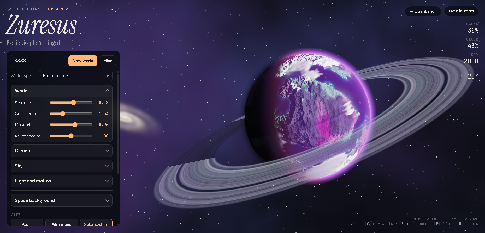

# SEEDWORLD — offline mirror

Full mirror of **SEEDWORLD** (https://openbench.fun/seedworld/).

Source: https://openbench.fun/seedworld/



## Stack

- **Single-document HTML5 game** — the entire game ships in one 96,705-byte
  `index.html`: zero external scripts of its own, zero build output, zero
  modules. (Its only external resource references are Google Fonts —
  preconnects + stylesheet — a CDN dependency that stays CDN, PLAN §1 socker
  precedent.)
- **Raw WebGL 1, hand-written** — no engine, no framework, no three.js: the
  renderer draws one full-screen triangle whose fragment shader raymarches the
  planet, and the GLSL sources (VS/COMMON/VIEW_FS/BAKE_FS) live inline as
  template literals. A companion **2D canvas** pass draws the solar-system
  view and the star/nebula background.
- **Everything is procedural** — no image textures, no models, no audio
  files: terrain is stacked 3D noise (fbm + ridged noise + domain warp),
  climate is latitude/altitude fields, clouds/city lights/rings/atmosphere are
  shader terms. A single number (the seed) drives a `mulberry32` PRNG
  throughout, so the same seed always grows the same world.
- **Browser-native exporters** — the "Textures" dialog bakes albedo / height
  (16-bit) / normal / roughness / clouds / emissive / ocean maps on the GPU
  (tiled FBO strips), encodes PNG by hand (zlib via `CompressionStream`) and
  packs a ZIP with a hand-rolled crc32; video capture uses `MediaRecorder`.
  The UI mentions Unity/Blender/Godot only as normal-map-format labels in the
  export dialog's "OpenGL / DirectX" dropdown — **there is no Unity, Godot or
  engine payload here at all**.
- **Openbench platform shell** — the page is a platform page (visit counter,
  "← Openbench" link) but the game itself is fully self-contained.

## What this is

SEEDWORLD (openbench.fun/seedworld/) — "Grow a planet from one number, tune
it, and export it as game-ready texture maps: albedo, height, normal,
roughness, clouds": an interactive procedural planet generator and texture
tool. Type a seed, and a world grows — temperate, ocean, desert, frozen,
exotic, lava or gas giant — that you can rotate, zoom, tune with sliders
(sea level, continents, mountains, warmth, moisture, clouds, atmosphere, sun,
tilt, spin), grow a solar system from the same seed, and export as
equirectangular texture maps (up to 8192×4096) or a video flythrough.

Captured whole: **2 files, 156,687 bytes** — the entry document (96,705 B,
carrying the entire game and stylesheet inline) and its `og.jpg` social card
(59,982 B, 1200×630). The full runtime closure was taken from the browser
network log (see below); there are no other assets.

The entry document preserved under `seedworld/` is byte-exact as served to a
plain fetch. Caveat recorded: Cloudflare (the origin's front) injects one
extra `<script src="https://static.cloudflareinsights.com/beacon.min.js/…">`
tag into browser-served responses; a plain fetch receives the pristine
document, and `tools/update.mjs` normalizes the beacon away so a
browser-saved copy can never be misread as drift.

External at runtime (documented gaps, not captured — PLAN §1/§4):

- **Google Fonts** — `fonts.googleapis.com/css2?family=Instrument+Serif…`
  plus 4 `fonts.gstatic.com` `.woff2` files (Instrument Serif ×2, Figtree,
  JetBrains Mono); the page falls back to system fonts offline. A CDN
  dependency that stays CDN — never backfilled (PLAN §1).
- **Openbench platform analytics** — `POST /api/hit?p=seedworld&…` (fire-and-
  forget visit counter) and `GET /api/stats` (returned "40 visits" during
  capture); dynamic POST/GET endpoints, not static files.
- **Cloudflare infra** — the injected insights beacon and `POST /cdn-cgi/rum`.

Genuine 404s (probed 2026-10-13, documented gaps): `seedworld/favicon.ico`,
`favicon.ico` (origin root), `seedworld/favicon.svg`,
`seedworld/apple-touch-icon.png`, `seedworld/site.webmanifest`,
`seedworld/manifest.json` — the page declares no icons and has no manifest.

## Layout

- `seedworld/` — the capture, at the origin's own sub-path: serving this repo
  root as site root reproduces `https://openbench.fun/seedworld/` exactly
  (`seedworld/index.html` is the entry; `seedworld/og.jpg` the social card).
- `.upstream/manifest.json` — sha256 for every captured file (Gen-A)
- `readable/` — prettified derived layer (pinned prettier 3.9.6): the inline
  game script (`index-inline-1.pretty.js`, 3,409 lines) and the inline
  stylesheet (`index-inline-1.pretty.css`, 793 lines), plus
  `index-inline-map.json` (inline byte ranges + sha256)
- `src/` + `split-spec.json` — 13 statement-aligned slices of the game script
  with the recorded derivation spec
- `tools/derive.mjs` — rebuild `readable/` + `src/` + `split-spec.json`
- `tools/update.mjs` — read-only drift probe against the live origin
- `tools/verify.mjs` — re-hash the capture against the manifest
- `tools/audit.js` — integrity gate for the derived layers (`AUDIT PASS`)
- `tools/vendor/prettier/` — the pinned prettier 3.9.6 renderer, vendored into
  this mirror (module API, all 13 language plugins; provenance and integrity
  hash in `VENDOR-README.md`) so `derive`/`audit` resolve it from this tree and
  never from a sibling mirror's gitignored `node_modules/`
- `docs/cover.png` — cover (gameplay: a ringed exotic world grown in the
  mirror, mid-tune), `docs/boot-2026-10-13.png` — boot evidence,
  `docs/network-log-2026-10-13.jsonl` — the raw browser network log (the
  runtime closure record)

## Assets

- **models** — none: the planet, rings, moon, star and background galaxies are
  all procedural (no mesh files, no glTF)
- **textures/images** — none in the game: every surface is GLSL; the only
  image in the repo is the platform social card `seedworld/og.jpg` (1 file,
  1200×630, referenced by `og:image`; never fetched at runtime)
- **audio** — none
- **fonts** — none captured: fonts come from the Google Fonts CDN at runtime
  (4 woff2 files — external, documented gap)
- **data** — none: worlds are generated from the seed, nothing is loaded

## Run

Serve this repo root with any static file server that supports directory
indexes (`/seedworld/` → `seedworld/index.html`), then open
`http://localhost:<port>/seedworld/` — the sub-path matters, exactly as on the
origin:

```
npx serve .
```

## Verify

```
node tools/verify.mjs          # re-hash the capture against the manifest
node tools/derive.mjs --check  # committed derived layers match a fresh re-derivation (writes nothing)
node tools/audit.js            # derived-layer integrity gate (AUDIT PASS)
node tools/check-exports.mjs   # public-export-name gate
```

The public-export-name gate reports `0 export table(s) checked` here, and that
is the honest count rather than a blind spot: the whole game is one inline
`<script>` wrapped in a single top-level IIFE, so the script declares **no
`export` statements at all** — there is no public export surface to compare.
The gate still runs, reports no name lost, and would go red if an export table
ever appeared unaccounted for.

## Updating from upstream

```
node tools/update.mjs     # read-only drift probe: what changed upstream
```

The probe never rewrites the capture — a mirror is a point-in-time snapshot.
Refreshing means re-running the fetch into a clean tree and re-cutting the
derived layers on top of the new capture (`node tools/derive.mjs`, then
`node tools/audit.js`).

### 2026-10-13 derivation note

Both derived layers are in place, cut from the recorded capture (capture bytes
untouched — `node tools/verify.mjs` re-hashes both files):

- `readable/` — pinned prettier 3.9.6 (module API, default options, single
  pass verified idempotent — never the CLI, it respects `.gitignore` and can
  silently echo its input), vendored in this mirror at `tools/vendor/prettier`
  and resolved from there, rendered the entry's **inline `<script>`** to
  `readable/index-inline-1.pretty.js` (3,409 lines) and its **inline
  `<style>`** to `readable/index-inline-1.pretty.css` (793 lines); both
  pretties are provably not a byte copy of their capture source and re-render
  byte-exact under the pinned version. Twin names follow the fleet convention:
  capture-root-relative with the `seedworld/` prefix stripped, nested dirs
  flattened with `__` (`index-inline-1…`).
- `src/` — 13 statement-aligned slices (`src/index-inline-1-NN.js`, exact
  2-line provenance header) of the game script, sliced one level deeper than
  usual: the script is a **single top-level IIFE**, so slices cut at the
  **IIFE body's** top-level statement boundaries (recorded as
  `slicingContext` in `split-spec.json`). 13/13 parse standalone
  (`node --input-type=module --check -`) and round-trip byte-exact to their
  readable line ranges. Windows target ~250-350 lines; the giant GLSL shader
  constants stay whole, so most windows land at 261-350 lines with three
  smaller residue windows (9/13/150 lines) where an oversized shader
  declaration closed the preceding window. 4 sections
  are indexed, never sliced, because they cannot stand alone: the IIFE wrapper
  head (`(function () {` + the `"use strict";` directive prologue) and tail
  (`})();`), and the two early-return guards (`if (!gl) {…return;}`,
  `if (!prog) {…return;}`).
- **Not minified** — the entry script is authored source: identifiers are the
  game's own names (`$`, `P`, `W`, `S`, `CLASSES`, `material()`, …), so the
  identifier-rename campaign (PLAN §5) does not apply to this mirror; that is
  recorded here rather than silently skipped.
- Non-code payload rule — `seedworld/og.jpg` is recorded in split-spec
  `notRendered` with size + sha256, no render pass.
- §0.4 fork-over-mirror checked 2026-10-13: openbench.fun publishes
  deployments, not sources, and no public upstream repo exists for Seedworld
  (the platform's own site has no source links; a GitHub search finds only
  this mirror), so the mirror stands.
- Network-log-led closure: the runtime graph was recorded from a full browser
  session (`network --all --follow`) through load and gameplay — the complete
  first-party closure is the entry document plus `og.jpg`; everything else the
  page touches is CDN/platform infra listed above. A static scan of the
  captured HTML (script/link refs, `fetch(`/`new URL`/`import(`, path
  literals) confirms it: the only URL literals in the game code are the OG
  meta, the Google Fonts link and the two platform endpoints.
- Derivation-day gates (2026-10-13): `node tools/verify.mjs` → `2 files
  checked, 0 problems`; `node tools/update.mjs` → `up to date: 2 captured
  files identical upstream` (at capture time; the probe is read-only and a
  later upstream change is drift, never a rewrite of the snapshot);
  `node tools/audit.js` → `AUDIT PASS` (13/13 round-trips, 2/2 pretties
  re-render byte-exact, 2 inline blocks with byte-range twins, 4/4 skipped
  wrapper/guard sections re-verified, capture manifest free of derived
  layers); serve probe — repo root served on loopback, `/seedworld/` and
  `/seedworld/og.jpg` over HTTP 200 with capture-identical sizes, gameplay
  verified in-browser (New world → new seed; Solar system → 6 planets; Textures
  → 6 maps baked live), listener killed, port closed (netstat). Rebuild with
  `node tools/derive.mjs`.
- Re-check (2026-10-27): `node tools/verify.mjs` → `2 files checked, 0
  problems`; `node tools/derive.mjs --check` → `the committed derived layers
  match a fresh re-derivation exactly (nothing written)`; `node tools/audit.js`
  → `AUDIT PASS`; `node tools/check-exports.mjs` → `0 export table(s) checked`,
  `no public export name lost`; `node tools/update.mjs` → `DRIFT: 1 changed,
  0 live-missing (of 2 captured)` — `seedworld/index.html` has changed upstream
  since capture; the snapshot is left untouched (a mirror is point-in-time).

## Mirror conventions

- **Capture layer** — the captured files are byte-exact copies of what the
  origin served; nothing in them is edited.
- **Readable layer** — `readable/` is derived (prettified) and never shipped
  to a browser; it exists so the game script can actually be read.
- **Provenance** — `.upstream/manifest.json` records sha256 for each captured
  artifact, and `tools/verify.mjs` re-checks it.
- **Drift** — `tools/update.mjs` is read-only: it reports what changed
  upstream and never rewrites the capture.

## Fleet status

<!-- mirror-status:start — feeds _standard/REPO-INDEX.md. Update ONLY your own mirror's block; never edit the shared index (PLAN §8). Rebuild: node _standard/build-index.mjs -->
<!-- cols: cls=classification · ver=verify 0 problems · upd=drift probe · man=manifest · rdbl=readable re-derived · src=reversed src · boot=boot test · top=offline-mirror topic · tag=backup tag · staged=staged not committed -->
| # | repo | cls | ver | upd | man | rdbl | src | boot | top | tag | staged |
|---|---|---|---|---|---|---|---|---|---|---|---|
| 307 | seedworld | mirror | ✓ | ✓ | ✓ | ✓ | ✓ | ✓ | ✓ | — | — |
<!-- mirror-status:end -->
